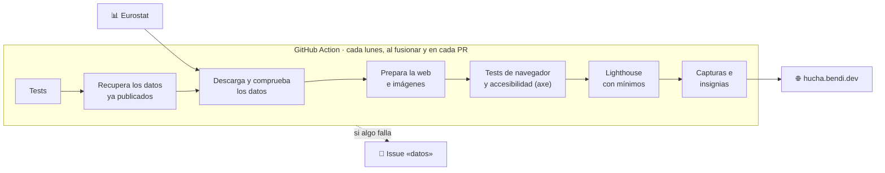

<div align="center">

<a href="https://hucha.bendi.dev/"></a>

# hucha

**Dónde va el dinero público en España, explicado claro.**<br>
Datos oficiales actualizados automáticamente. Sin cookies, sin anuncios, sin registro.

[](https://hucha.bendi.dev/)

[](https://github.com/serbenda/hucha/actions/workflows/publicar.yml)
[](https://github.com/serbenda/hucha/actions/workflows/publicar.yml)
[](https://github.com/serbenda/hucha/actions/workflows/publicar.yml)
[](https://github.com/serbenda/hucha/actions/workflows/publicar.yml)
[](https://github.com/serbenda/hucha/actions/workflows/publicar.yml)
<br>


[](https://github.com/sponsors/serbenda)
[](LICENSE)

<a href="https://hucha.bendi.dev/"></a>

</div>

---

## Tres preguntas

| | Página | Qué responde |
|---|---|---|
| 🧾 | **[Tu ticket](https://hucha.bendi.dev/)** | Escribes tu sueldo bruto y ves cuánto pones al año (IRPF y Seguridad Social, y si quieres lo que paga tu empresa) y a dónde va cada euro. |
| 📊 | **[A dónde va](https://hucha.bendi.dev/a-donde-va/)** | Todo el gasto público en 14 partidas que se entienden, en euros por habitante, con lo que incluye cada una y su evolución frente a la media europea. |
| 🏛️ | **[Quién gasta](https://hucha.bendi.dev/quien-gasta/)** | Qué parte de cada cosa pagan el Estado, las comunidades, los ayuntamientos y la Seguridad Social. |

El tono es neutral a propósito: cifras, comparaciones con la misma vara y fuentes al lado. Nada de adjetivos.

<table>
<tr>
<td width="50%"></td>
<td width="50%"></td>
</tr>
</table>

<div align="center">

&nbsp;&nbsp;

<br>
<sub>Pensada para el móvil, con modo oscuro. Las capturas se hacen solas en cada publicación con los datos de ese día.</sub>
</div>

---

## De dónde salen los datos

| Fuente | Qué se usa | Se actualiza |
|---|---|---|
| [Eurostat `gov_10a_exp`](https://ec.europa.eu/eurostat/databrowser/view/gov_10a_exp/default/table) | Gasto de las Administraciones Públicas por funciones (COFOG), de España por administración y de la media de la UE, en millones de euros y % del PIB, desde 2010. Para España lo elabora la IGAE. | Anual (febrero), con revisiones en abril y octubre |
| [Eurostat `demo_gind`](https://ec.europa.eu/eurostat/databrowser/view/demo_gind/default/table) | Población media anual, para los euros por habitante | Anual |
| [Agencia Tributaria](https://www3.agenciatributaria.gob.es/static_files/Sede/Programas_ayuda/Retenciones/2026/ALGORITMO_2026.pdf) y orden de cotización | Reglas del IRPF y de las cotizaciones de 2026, para el ticket | A mano, cada año |

Es gasto **realmente hecho** (contabilidad nacional), no el presupuesto: los Presupuestos Generales vigentes son los de 2023 prorrogados.

---

## Cómo funciona

Web **estática**: HTML, CSS y JavaScript sin frameworks ni dependencias. Una GitHub Action descarga los datos, los prueba y publica en GitHub Pages. Los datos no se guardan en el repositorio.



- Si Eurostat falla o los datos no tienen buena pinta (pocos años, más de un 5 % del gasto sin detalle, o un año más antiguo que lo publicado), **la web sigue con los últimos datos buenos** y se abre un issue con la etiqueta `datos`. Se cierra solo cuando vuelve a funcionar.
- **Tests de navegador** con Playwright en todas las páginas, en móvil y escritorio y en modo claro y oscuro: sin errores, sin desbordar, el ticket calcula bien, compartir no lleva el sueldo, y **auditoría de accesibilidad** con axe (WCAG 2.2 AA).
- **Lighthouse** en móvil para cada página, con mínimos: rendimiento 90, accesibilidad 100, buenas prácticas 95 y SEO 100. Si no llega, **no se publica**.
- En las PR hace todo menos publicar, así que el check de la PR ya dice si todo va bien.
- Las Actions están fijadas por commit.

---

## Estructura

```
hucha/
├── index.html                Tu ticket
├── a-donde-va/  quien-gasta/  fuentes/
├── assets/
│   ├── css/estilos.css       Un solo fichero de estilos, con modo oscuro
│   ├── img/favicon.svg       Logo
│   └── js/
│       ├── jsonstat.js       Lector del formato de Eurostat
│       ├── cofog.js          Partidas, quién gasta, por habitante (navegador y Node)
│       ├── impuestos.js      IRPF y cotizaciones de 2026
│       ├── formato.js        Números y fechas en castellano
│       └── …                 Un script por página, datos.js y comun.js
├── scripts/                  Datos, fuente, imágenes, Lighthouse y capturas
├── tests/                    Tests unitarios (node:test) y de navegador (tests/e2e)
└── sw.js                     Funciona sin conexión
```

Los módulos de `assets/js/` son los mismos en el navegador y en Node: lo que prueban los tests es lo que corre en la web.

---

## En local

Node 20 o superior, sin nada que instalar.

```bash
npm test          # tests unitarios
npm run datos     # descarga los datos reales de Eurostat a data/
npm run ejemplo   # o, sin conexión, datos de EJEMPLO (la web lo avisa con una banda)
npm run dev       # sirve la web en local
```

Para tenerlo todo, como en la Action (imágenes, tests de navegador, Lighthouse y capturas):

```bash
npm run herramientas && npx playwright install chromium
node scripts/vendor.mjs && npm run imagenes
# copia la web a _site/ como hace la Action y luego:
npm run e2e && npm run lighthouse && npm run capturas
```

---

## Mantenimiento

| Si cambia… | Dónde se toca |
|---|---|
| El IRPF, las cotizaciones o el salario mínimo (cada enero) | `REGLAS` en `assets/js/impuestos.js` y sus tests |
| Cómo se agrupan las partidas | `PARTIDAS` en `assets/js/cofog.js` (la tabla de la página de fuentes sale de ahí) |
| Los mínimos de Lighthouse | `CATEGORIAS` en `scripts/lighthouse.mjs` |
| Una fuente deja de responder | Llega un issue `datos`; la web sigue con los últimos datos buenos |

---

## Licencia

**© 2026 Bendi. Todos los derechos reservados.** El repositorio es público para que se pueda ver el código, pero no se concede licencia de uso. Detalles en [LICENSE](LICENSE).

Los datos pertenecen a sus fuentes y se reutilizan según sus condiciones. hucha no está vinculada a ningún organismo público, partido ni empresa.

<div align="center">
<br>
<a href="https://bendi.dev"></a>
</div>
