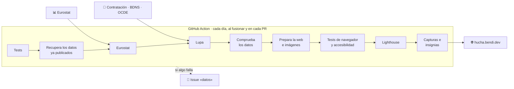

<div align="center">

<a href="https://hucha.bendi.dev/"></a>

# hucha

**Dónde va el dinero público en España, explicado claro.**<br>
Datos oficiales actualizados automáticamente. Sin cookies, sin anuncios, sin registro.

[](https://hucha.bendi.dev/)

[](https://github.com/serbenda/hucha/actions/workflows/publicar.yml)
[](https://github.com/serbenda/hucha/actions/workflows/publicar.yml)
[](https://github.com/serbenda/hucha/actions/workflows/publicar.yml)
[](https://github.com/serbenda/hucha/actions/workflows/publicar.yml)
[](https://github.com/serbenda/hucha/actions/workflows/publicar.yml)
<br>


[](https://github.com/sponsors/serbenda)
[](LICENSE)

<a href="https://hucha.bendi.dev/"></a>

</div>

---


## Índice

1. [Qué es](#qué-es)
2. [Las páginas](#las-páginas)
3. [De dónde salen los datos](#de-dónde-salen-los-datos)
4. [Cómo se calcula cada cifra](#cómo-se-calcula-cada-cifra)
5. [La Lupa a fondo](#la-lupa-a-fondo)
6. [Privacidad y datos personales](#privacidad-y-datos-personales)
7. [Cómo se publica](#cómo-se-publica)
8. [Calidad: tests, accesibilidad y rendimiento](#calidad-tests-accesibilidad-y-rendimiento)
9. [Avisos cuando algo falla](#avisos-cuando-algo-falla)
10. [Los ficheros de datos](#los-ficheros-de-datos)
11. [Estructura del código](#estructura-del-código)
12. [Diseño](#diseño)
13. [En local](#en-local)
14. [Mantenimiento: qué tocar cuando cambia algo](#mantenimiento-qué-tocar-cuando-cambia-algo)
15. [Lo que no aparece (todavía)](#lo-que-no-aparece-todavía)
16. [Hoja de ruta](#hoja-de-ruta)
17. [Cómo se trabaja en el repositorio](#cómo-se-trabaja-en-el-repositorio)
18. [Licencia](#licencia)

---

## Qué es

hucha es una web que enseña **a dónde va el dinero público en España** a cualquiera, sin saber de economía. Responde a cinco preguntas: cuánto pongo yo, a qué se dedica, quién lo gasta, si se gasta lo presupuestado y a quién se le paga.

Principios que guían cada decisión:

| Principio | Qué significa en la práctica |
|---|---|
| **Solo datos oficiales** | Cada cifra sale de un organismo público (Eurostat, IGAE, Plataforma de Contratación, BDNS, OCDE, Agencia Tributaria) y lleva su fuente al lado. |
| **Neutral** | Sin adjetivos ni opiniones. Se compara con la misma vara (la media de la UE, el mismo año, la misma clasificación). |
| **Se actualiza sola** | Una GitHub Action descarga los datos cada día. Nadie toca las cifras a mano. |
| **Si una fuente falla, no se inventa nada** | La web sigue con los últimos datos buenos y se abre un aviso. |
| **Dice lo que no cubre** | Cada sección explica qué queda fuera, para no dar una imagen incompleta como si fuera completa. |
| **Privada** | Sin cookies, sin cuentas, sin anuncios. Tu sueldo no sale de tu navegador. Las personas físicas no aparecen con nombre. |
| **Para todos** | Accesible (WCAG 2.2 AA, 100 en Lighthouse), rápida en un móvil normal y con modo oscuro. |

---

## Las páginas

<table>
<tr>
<td width="50%"></td>
<td width="50%"></td>
</tr>
</table>

<div align="center">

&nbsp;&nbsp;

<br>
<sub>Pensada para el móvil, con modo oscuro. Las capturas se hacen solas en cada publicación con los datos de ese día.</sub>
</div>


### 🧾 Tu ticket · [`/`](https://hucha.bendi.dev/)

Escribes tu sueldo bruto anual y sale un ticket con:

- **Lo que pones al año**: IRPF y Seguridad Social del trabajador. Con el interruptor, también lo que paga tu empresa por ti.
- **A dónde va**: ese total repartido entre las 14 partidas, en la misma proporción que el gasto público real del último año.
- **Compartir el reparto**: comparte los porcentajes, **nunca el sueldo**. Los enlaces antiguos con `?sueldo=` y `?empresa=1` se siguen aceptando.
- **Entre todos**: el gasto total, por habitante y en % del PIB frente a la media de la UE.

En el móvil, debajo del campo del sueldo aparece un resumen («Pones X € al año · ver a dónde va ↓») para no tener que bajar a ciegas.

### 📊 A dónde va · [`/a-donde-va/`](https://hucha.bendi.dev/a-donde-va/)

Todo el gasto público en **14 partidas** que se entienden, en euros por habitante. Al abrir cada una:

- **En qué se va**: el segundo nivel de la clasificación (hospitales, centros de salud, medicamentos; infantil, secundaria, universidad…).
- **Cómo se gasta**: sueldos, compras, pagos a personas, inversión, subvenciones, intereses…
- **Frente a Europa**: el % del PIB de España y de la media de la UE, con una gráfica desde 2010 (con la marca del COVID en 2020).

Arriba, tres cifras: gasto por habitante, la partida más grande y el gasto sobre el PIB. Y un bloque con **cómo se gasta cada euro** del total.

### 🏛️ Quién gasta · [`/quien-gasta/`](https://hucha.bendi.dev/quien-gasta/)

Qué parte de cada cosa pagan el **Estado**, las **comunidades**, los **ayuntamientos** y la **Seguridad Social**: cuánto gasta cada administración y, para cada función (sanidad, educación, pensiones…), una barra con el reparto.

### 📈 Presupuesto · [`/presupuesto/`](https://hucha.bendi.dev/presupuesto/)

¿Se gasta lo que se presupuesta? El presupuesto del Estado de este año frente a lo que lleva gastado, con los datos que publica cada mes la IGAE:

- **Tres cifras**: el presupuesto del año, lo gastado hasta el último mes publicado y lo que se llevaba gastado un año antes a esas alturas.
- **A qué ritmo**: la parte gastada al final de cada mes, este año y el anterior, frente a un ritmo igual todo el año.
- **En qué tipo de gasto** (sueldos, compras, intereses, transferencias, inversiones…) y **para qué** (políticas: defensa, infraestructuras, sanidad…), con una raya que marca la parte del año que ha pasado.
- **Quién lo gasta**: cada ministerio y, al pulsarlo, sus programas, con un buscador («ferroviario», «becas»…). Se puede enlazar una búsqueda: `/presupuesto/?q=ferroviario`.

Sin adjetivos: el ritmo del gasto no es igual todo el año (las inversiones se concentran al final), así que la comparación justa es con el mismo mes del año anterior, y la página lo explica.

### 🔍 La Lupa · [`/lupa/`](https://hucha.bendi.dev/lupa/)

El detalle con nombre y cifra:

- **Contratos** adjudicados desde 1 millón de €: quién paga, quién gana, cuánto, para qué y el enlace al expediente.
- **Subvenciones** concedidas desde 1 millón de € a empresas y entidades en los últimos 12 meses.
- **Ayuda a otros países**: la ayuda oficial al desarrollo de España por país.

Buscador (todas las palabras, sin importar tildes ni mayúsculas), filtros por **tema** (tren, carreteras, sanidad, educación… 15 en total) y por **administración**. La búsqueda queda en la dirección, así que se puede compartir: [`/lupa/?q=adif&tema=tren`](https://hucha.bendi.dev/lupa/?q=adif&tema=tren).

### 📖 Fuentes · [`/fuentes/`](https://hucha.bendi.dev/fuentes/)

Primero, **en pocas palabras** y con un **glosario** de las palabras que salen en la web (PIB, créditos, obligaciones, acuerdo marco…), para quien no sabe de economía. Después, el detalle: de dónde sale cada cifra, la tabla de cómo se agrupan las partidas (generada desde el código, así que nunca se desfasa), el presupuesto, la Lupa, cómo se calcula el ticket, privacidad y cómo avisar de un error. Al final, el **aviso legal**: quién está detrás, qué es y qué no es, reutilización de datos públicos (Ley 37/2007), exactitud y responsabilidad, datos personales (minimización de personas físicas, cómo pedir que se retire algo), propiedad intelectual, enlaces y ley aplicable.

---

## De dónde salen los datos

| Fuente | Qué se usa | Cada cuánto publica | Cada cuánto lo mira hucha |
|---|---|---|---|
| [Eurostat `gov_10a_exp`](https://ec.europa.eu/eurostat/databrowser/view/gov_10a_exp/default/table) | Gasto de las Administraciones Públicas por funciones (COFOG) y por tipo de operación, de España por administración y de la media de la UE, desde 2010. Para España lo elabora la [IGAE](https://www.igae.pap.hacienda.gob.es/). | Anual (febrero), con revisiones en abril y octubre | Cada día |
| [Eurostat `demo_gind`](https://ec.europa.eu/eurostat/databrowser/view/demo_gind/default/table) | Población media anual, para los euros por habitante | Anual | Cada día |
| [IGAE · ejecución del presupuesto](https://www.igae.pap.hacienda.gob.es/sitios/igae/es-ES/Contabilidad/ContabilidadPublica/CPE/EjecucionPresupuestaria/Paginas/imejecucionpresupuesto.aspx) | Presupuesto del Estado (créditos definitivos) y lo gastado (obligaciones reconocidas), por capítulos, ministerios, políticas y programas | Cada mes, con unos dos meses de retraso | Cada día |
| [Plataforma de Contratación del Sector Público](https://contrataciondelestado.es/) | Contratos adjudicados desde 1 M€, de los órganos que publican en ella y de las plataformas autonómicas y locales que se agregan | Continuo | Cada día; el histórico crece solo |
| [BDNS · Infosubvenciones](https://www.infosubvenciones.es/) | Subvenciones concedidas desde 1 M€ a empresas y entidades, últimos 12 meses | Continuo | Cada día |
| [OCDE · CRS](https://data-explorer.oecd.org/) | Ayuda oficial al desarrollo de España por país, por sector y proyecto a proyecto | Anual (finales del año siguiente) | Cada día |
| [Agencia Tributaria](https://www3.agenciatributaria.gob.es/static_files/Sede/Programas_ayuda/Retenciones/2026/ALGORITMO_2026.pdf) y orden de cotización (BOE) | Reglas del IRPF y de las cotizaciones de 2026, para el ticket | Anual | A mano, cada enero |

Es gasto **realmente hecho** (contabilidad nacional), no el presupuesto. Llega con retraso: los datos de un año salen a principios del año siguiente al siguiente, y el último año va marcado como provisional.

<details>
<summary><strong>Eurostat: cómo se pide y qué se comprueba</strong></summary>

- API de difusión en JSON-stat 2.0: `https://ec.europa.eu/eurostat/api/dissemination/statistics/1.0/data/<tabla>?…&lang=EN`. Con `lang=ES` responde con error: los nombres en castellano salen del propio código (`GRUPOS` en `cofog.js`).
- **Gasto** (`urlGasto`): `gov_10a_exp`, operación `TE` (gasto total), unidades `MIO_EUR` y `PC_GDP`, sectores `S13` (todas), `S1311` (Estado), `S1312` (comunidades), `S1313` (ayuntamientos) y `S1314` (Seguridad Social), funciones COFOG de primer y segundo nivel, España y `EU27_2020`, desde 2010.
- **Tipos de gasto** (`urlTipos`): la misma tabla con las operaciones `D1`, `D62`, `P2`, `D632`, `P5`, `D3`, `D4`, `D7` y `D9`, desde 2015. Si falla, se mantienen los anteriores y la web lo aguanta.
- **Población** (`urlPoblacion`): `demo_gind`, indicador `AVG`.
- `jsonstat.js` aplana el formato (valores densos o dispersos) y guarda el estado de cada dato (`p` = provisional).
- Antes de guardar, `problema()` en `cofog.js` rechaza los datos si: no hay años, hay menos de 5, ningún año tiene gasto y población a la vez, el gasto total es sospechoso, o falta detalle para más del 5 % del gasto.
- **No retroceder**: si lo ya publicado llega a un año más reciente que lo que devuelve Eurostat, no se sobrescribe.
- Eurostat a veces responde con un JSON de error o con la tabla «en preparación»: se reintenta y, si no, se queda la versión anterior.
</details>

<details>
<summary><strong>IGAE: ejecución del presupuesto del Estado</strong></summary>

- La página del año en curso (`imejecucionpresupuesto.aspx`) y la de cada año anterior (`imejecucionpresupuestoAAAA.aspx`) enlazan un libro de Excel por mes: `MENSUAL <MES> <AÑO>.xlsx` (algunos con «(EXCEL)» en el nombre). Los anexos no se usan.
- Del libro se leen cuatro hojas: `GTOS 004` (capítulos, con el mismo mes del año anterior), `GTOS 014` (secciones, con el año anterior), `GTOS 016` (áreas de gasto y políticas) y `GTOS 017` (programas por sección). Importes en miles de euros, que se guardan en millones.
- Los libros se leen sin dependencias (`scripts/xlsx.mjs`: un .xlsx es un ZIP con XML). Las columnas se buscan por su cabecera («CRÉDITOS DEFINITIVOS», «OBLIGACIONES RECONOCIDAS»…), no por su letra, y se comprueba que el libro dice el mes que toca. Un guion de la fuente se guarda como «sin dato», nunca como cero.
- Cada día se leen los meses que faltan en el almacén y, siempre, el último de cada año, por si se ha revisado. Se guardan el año en curso y el anterior.
- Hay más en el libro que hucha aún no usa: modificaciones del presupuesto, ingresos, déficit de caja y la ejecución del Mecanismo de Recuperación (fondos europeos) por ministerio.
</details>

<details>
<summary><strong>Plataforma de Contratación: feeds y cursores</strong></summary>

- Dos feeds ATOM con los pliegos en formato CODICE:
  - `sindicacion_643/licitacionesPerfilesContratanteCompleto3.atom`: los órganos que publican directamente (Estado y muchos más).
  - `sindicacion_1044/PlataformasAgregadasSinMenores.atom`: las plataformas propias de comunidades y ayuntamientos que se agregan a la estatal, sin contratos menores.
- Cada página pesa unos 7 MB y enlaza a la anterior con `rel="next"`: se leen de lo más nuevo hacia atrás.
- **Lo nuevo, cada día**: desde la portada del feed hasta lo ya leído. Suelen ser pocas páginas.
- **El mes en curso**: hacia atrás con las páginas del feed, hasta el día 1.
- **El histórico**: con los **ficheros mensuales** de la Plataforma (`…_AAAAMM.zip`, un ZIP por mes con todas las páginas de ese mes: unos 200 MB y unos 60.000 movimientos). Se baja uno por feed y ejecución (`LUPA_MESES`), del más reciente al más antiguo, y se lee página a página con `unzip`, sin descomprimirlo entero.
- El punto por el que va cada feed (`cursores`: lo más nuevo leído, hasta dónde llegó el feed y el siguiente mes del histórico) se guarda en el propio `contratos.json` del almacén.
- Límites por ejecución: `LUPA_PAGINAS` páginas del feed (40 en la publicación diaria, 3 en las PR), 9 minutos por feed y un mes del histórico.
- Se guardan hasta **2 años** por fecha de adjudicación.
</details>

<details>
<summary><strong>BDNS: la API de concesiones</strong></summary>

- `https://www.infosubvenciones.es/bdnstrans/api/concesiones/busqueda?vpd=GE&fechaDesde=dd/mm/aaaa&fechaHasta=dd/mm/aaaa&page=N&pageSize=200&order=importe&direccion=desc`
- El orden se pide con `order` y `direccion`. Con el habitual `sort` responde, pero sin ordenar.
- Se piden los 12 últimos meses, mes a mes, hasta 10 páginas por mes, y se para al bajar del umbral. El script **comprueba que vienen ordenadas**: si no, falla con los primeros importes para verlo.
</details>

<details>
<summary><strong>OCDE: ayuda oficial al desarrollo (CRS)</strong></summary>

- El **Creditor Reporting System** recoge, proyecto a proyecto, la ayuda que declara cada país donante. Se pide al servicio de la OCDE para ayuda al desarrollo (`sdmx.oecd.org/dcd-public`), flujo `DSD_CRS@DF_CRS` versión 1.7, en CSV con etiquetas.
- Dimensiones de la clave: donante, receptor, sector, medida, canal, modalidad, tipo de flujo, base de precios, nivel de detalle, identificador y unidad.
- **Totales** (`urlCrs`): `ESP...100._T._T.D.V._T..`: España, todos los receptores y sectores, ayuda oficial (100), todos los canales y modalidades, desembolsos (D), dólares corrientes (V), agregados (_T). Unos 3,5 MB por año.
- **Proyectos** (`urlCrsProyectos`): `ESP...100...D.V.DD..` del último año: los microdatos, con título, descripción, sector, agencia y canal. Se leen por trozos (`lectorCsv`) y se guardan los 25 mayores de cada país.
- **Sectores**: los códigos de la OCDE se agrupan en 26 sectores que no se solapan (`SECTORES_AYUDA`): educación, salud, agua, gobierno y derechos, emergencias, refugiados acogidos en España… El total de España por sector sale del receptor `DPGC` (países en desarrollo, total), que incluye lo que va a regiones y sin país concreto.
- Solo se quedan como países los receptores que lo son (`esPais()`), con su nombre en castellano por `Intl.DisplayNames`. Las agencias y los canales se traducen (AECID, ayuntamientos, ONG y sociedad civil…).
- La OCDE limita las consultas (unas 20 por hora): la Action hace dos al día.
</details>

---

## Cómo se calcula cada cifra

### Las 14 partidas

Cada partida junta funciones COFOG de Naciones Unidas. Entre todas cubren el **100 % del gasto sin contar nada dos veces** (hay un test que lo comprueba). Si a un año le falta detalle, la diferencia va a «Sin detalle» para que las cuotas sigan sumando 100 %.

| Partida | Funciones COFOG |
|---|---|
| Pensiones de jubilación y viudedad | GF1002, GF1003 |
| Sanidad | GF07 |
| Educación | GF09 |
| Bajas, incapacidad, familia y otras ayudas | GF10 (menos GF1002, GF1003, GF1005) |
| Funcionamiento de las administraciones | GF01 (menos GF0107) |
| Empleo, empresas, campo y energía | GF04 (menos GF0405) |
| Intereses de la deuda | GF0107 |
| Carreteras, trenes y transporte | GF0405 |
| Paro | GF1005 |
| Policía, justicia y prisiones | GF03 |
| Cultura, deporte y religión | GF08 |
| Medio ambiente y basuras | GF05 |
| Defensa | GF02 |
| Vivienda, urbanismo y agua | GF06 |

- **Euros por habitante** = gasto de la partida (millones de €) × 10⁶ ÷ población media del año.
- **Frente a Europa** = % del PIB de España frente a la media de la UE-27, misma partida y mismo año.
- **En qué se va** = los grupos COFOG de segundo nivel de la partida, con sus nombres en castellano (`GRUPOS`).
- **Cómo se gasta** = las 9 operaciones de contabilidad nacional; lo que no encaja en ninguna va a «Otros».

### Quién gasta

- Cuánto gasta cada administración no cuenta las transferencias generales entre administraciones (GF0108), para no contar dos veces el dinero que el Estado pasa a comunidades y ayuntamientos para que lo gasten ellos.
- El reparto de cada función es la cuota de cada sector sobre la suma de los cuatro.

### Tu ticket

Calcula lo que paga un asalariado con contrato indefinido, sin hijos ni deducciones, con las reglas de 2026 (`REGLAS` en `impuestos.js`):

| Paso | Regla |
|---|---|
| **Seguridad Social del trabajador** | 6,50 % del bruto hasta la base máxima (61.214,40 € al año), más la cotización de solidaridad por encima de ella |
| **Empresa** (opcional) | 30,65 % hasta la base máxima, más su parte de solidaridad |
| **Rendimiento neto** | bruto − cotizaciones del trabajador |
| **Reducción por trabajo** | 7.302 € hasta 14.852 € de rendimiento neto; baja en dos tramos hasta 0 € a partir de 19.747,50 € |
| **Base** | rendimiento neto − reducción − 2.000 € de otros gastos |
| **Cuota** | escala estatal + autonómica general (19 %, 24 %, 30 %, 37 %, 45 %, 47 %) sobre la base, menos la misma escala sobre el mínimo personal (5.550 €) |
| **Límites** | 0 € hasta el salario mínimo (17.094 €) y, por encima, nunca más del 43 % de lo que pasa del salario mínimo, para que no haya saltos |

Con 30.000 € brutos: IRPF 4.926 € y Seguridad Social 1.950 € (hay tests con estos valores). El reparto aplica a ese total las cuotas de las partidas del último año.

**No entran** el IVA ni los impuestos especiales (dependen de lo que compres), el IBI ni otros impuestos locales, y las particularidades de cada comunidad. Como las administraciones gastan más de lo que ingresan, parte del gasto se paga con deuda.

---

## La Lupa a fondo

### Contratos

| Qué | Cómo |
|---|---|
| **Qué entra** | Contratos en estado `ADJ` (adjudicado) o `RES` (resuelto) con al menos **1 millón de € adjudicado, sin IVA** |
| **Importe** | La suma de los lotes con resultado 8 (adjudicado) o 9 (formalizado). Los desiertos y desistidos no cuentan |
| **Quién gana** | Las empresas adjudicatarias de cada lote, sin repetir. Las personas físicas salen como «Persona física» |
| **Quién paga** | El órgano de contratación y, por su jerarquía, el **nivel**: Estado, Comunidades, Ayuntamientos, Universidades u Otros, y el **lugar** |
| **Tipo** | Suministro, Servicios, Obras, Concesión… (código `TypeCode`) |
| **Para qué** | Por el primer código CPV: Obra (45), Mantenimiento y reparación (50), Compra de bienes (0-3), Servicios y estudios, Transporte y logística |
| **Temas** | Los 15 temas por CPV y por palabras del título (tabla `TEMAS` en `lupa-datos.js`). Un contrato puede tener varios |
| **Licitado frente a adjudicado** | Si difieren, la ficha dice cuánto baja o sube |
| **Acuerdos marco** | Si es un acuerdo marco o un sistema dinámico de adquisición (`ContractingSystemCode` 1 o 2, o el título si no viene), su importe es un **techo** de lo que se podrá gastar después, no gasto. Sale como «como máximo» y **no suma en los totales**. Los contratos *basados* en un acuerdo marco sí son gasto y cuentan |

### Subvenciones

Concesiones desde 1 millón de € de los últimos 12 meses. Para cada una: quién la recibe, cuánto, la convocatoria (con enlace), el órgano que la concede y su nivel. **Las concedidas a personas físicas no se incluyen.**

### Ayuda a otros países

Desembolsos de ayuda oficial al desarrollo, en millones de dólares de cada año:

- **En qué se da**: toda la ayuda de España por sector, también la que no va a un país concreto. Pulsando un sector, la lista enseña a qué países va lo de ese sector.
- **A qué países**: los que más reciben, y la lista completa con su evolución.
- **Año a año**: el total de cada año.
- **Cada país**, al pulsarlo: en qué sectores se le da, su evolución y sus **mayores proyectos** del último año (título, descripción, sector, quién lo da y por qué canal). Se puede compartir: `?tab=ayuda&pais=MAR`.

### Cómo se busca

- Todo en el navegador, sin servidor. Al abrir solo se descarga el **índice** (unos KB): los 40 mayores, los totales por tema, por administración y por mes, y la lista de meses. Con él se pinta el **panorama** (gráficos por tema, quién paga y mes a mes) y la primera página.
- Al buscar, filtrar o pulsar «Ver más» se piden los **ficheros de cada mes**, todos a la vez, y los resultados van saliendo según llegan («Buscando en 12 de 24 meses…»). Con un solo filtro, el total sale al momento del índice. Los meses empiezan a bajar en cuanto tocas el buscador o los filtros.
- Pulsar una barra del panorama filtra la lista por ese tema o esa administración.
- Se buscan **todas las palabras** en título, órgano, empresas, lugar, tipo y finalidad, sin importar tildes ni mayúsculas, y se ordena por importe.
- El estado (pestaña, búsqueda, tema y nivel) va en la dirección: `?tab=subvenciones&q=…&tema=…&nivel=…`.

---

## Privacidad y datos personales

- **Sin cookies, sin cuentas, sin anuncios.**
- **Tu sueldo no sale de tu navegador**: el ticket se calcula en tu dispositivo y, al compartir, solo van los porcentajes.
- **Visitas** contadas con [GoatCounter](https://www.goatcounter.com/), que no guarda datos personales ni usa cookies.
- **Personas físicas**: en contratos salen como «Persona física» (se detectan por el NIF: empieza por número o por X, Y, Z, K, L o M); en subvenciones no se incluyen. Lo comprueba un test.
- **Para avisar de un error** se usan los issues de GitHub, que son públicos: la web avisa de no poner datos personales.

---

## Cómo se publica

Web **estática**: HTML, CSS y JavaScript sin frameworks ni dependencias en la web. Una GitHub Action descarga los datos, los comprueba y publica en GitHub Pages. **Los datos no se guardan en el repositorio**: cada ejecución parte de los últimos publicados.



| Paso | Qué hace | Si falla |
|---|---|---|
| Tests | `npm test` | No sigue |
| Recuperar el almacén | Descarga los datos acumulados de la release `almacen` (si aún no existe, de la web publicada) | Empieza de cero |
| Eurostat | `npm run datos` | Se queda lo anterior y queda anotado |
| Presupuesto | `node scripts/fetch-ejecucion.mjs`: los libros de la IGAE que falten | Se queda lo anterior y queda anotado |
| Lupa | `npm run lupa` (30 minutos como mucho) | Cada parte por separado: se queda su versión anterior |
| Escaparate | `npm run escaparate`: del almacén, lo que descarga cada página (vistas, índices y meses) | No sigue |
| Comprobar que hay datos | Que existan y que no sean de ejemplo | No sigue |
| Resumen | Anotaciones con las cifras clave (partidas, quién gasta, mayores contratos…) para revisarlas en la PR sin abrir la web | — |
| Herramientas | Playwright, axe, Lighthouse y la fuente Archivo (solo para construir: la web no tiene dependencias) | No sigue |
| Imágenes | Iconos y la imagen para compartir con los datos del día (`compartir.png`) | No sigue |
| Preparar la web | Copia a `_site/` y añade `?v=<commit>` a estilos, scripts e imports, para que nadie mezcle HTML nuevo con JS viejo | No sigue |
| Tests de navegador | Playwright y axe | No sigue |
| Lighthouse | Ver [calidad](#calidad-tests-accesibilidad-y-rendimiento) | Según la categoría |
| Capturas | Las del README, con los datos del día | Siguen las anteriores |
| Guardar el almacén | Sube los datos acumulados a la release `almacen` (solo desde `main`, y aunque la web no llegue a publicarse) | Aviso |
| Publicar | GitHub Pages (solo desde `main`) | Aviso |
| Avisar | Abre o cierra el issue `datos` | — |

**Cuándo se ejecuta**: cada día a las 05:17 UTC (06:17 en invierno y 07:17 en verano en la España peninsular), al fusionar en `main`, a mano y en cada PR. En las PR hace todo **menos publicar**, así que el check de la PR ya dice si todo va bien. Las Actions están fijadas por commit, con la versión en un comentario.

**Funciona sin conexión**: el service worker (`sw.js`) guarda las páginas, los estilos, los scripts y los datos. Al cambiar algo de la web se sube su versión (`hucha-vN`).

---

## Calidad: tests, accesibilidad y rendimiento

### Tests unitarios (`npm test`, con `node:test`)

Los módulos de `assets/js/` son los mismos en el navegador y en Node: **lo que se prueba es lo que corre en la web**.

| Fichero | Qué comprueba |
|---|---|
| `tests/cofog.test.js` | Lectura de JSON-stat; URLs de Eurostat; que las partidas cubren el 100 % sin solaparse; «Sin detalle»; datos insuficientes; gasto por persona; serie frente a la UE; quién gasta; nombres de todos los grupos; en qué se va y cómo se gasta |
| `tests/impuestos.test.js` | Escala por tramos; cotizaciones y base máxima; reducción por trabajo; IRPF cero hasta el salario mínimo y sin saltos; 30.000 € de ejemplo; que crece con el sueldo; formatos |
| `tests/lupa.test.js` | Lectura del feed de contratos con lotes; personas físicas; umbral; nivel por jerarquía; temas y finalidad; subvenciones; ayuda de la OCDE (lector de CSV, países, sectores y proyectos); búsqueda; botones de temas; índice y meses; acuerdos marco; iconos |

### Tests de navegador (`npm run e2e`, Playwright)

Todas las páginas en **móvil y escritorio, modo claro y oscuro**: sin errores de JavaScript, sin desbordar la pantalla, y **auditoría de accesibilidad con axe** (WCAG 2.2 AA). Además: el ticket calcula y suma el 100 %, el resumen del móvil, compartir no lleva el sueldo, los enlaces antiguos, el detalle y la gráfica de cada partida, quién gasta, la tabla de fuentes, la 404, el SEO de cada página y la Lupa (buscador, temas, nivel, estado en la dirección, subvenciones y ayuda).

### Lighthouse (`npm run lighthouse`, móvil)

| Categoría | Mínimo | Si no llega |
|---|---:|---|
| Rendimiento | 90 | Se mide hasta dos veces más y cuenta la mejor. En las PR, no se fusiona. En la publicación diaria, **se publica igual** con los datos nuevos y se abre el aviso |
| Accesibilidad | 100 | No se publica |
| Buenas prácticas | 95 | No se publica |
| SEO | 100 | No se publica |

Si el rendimiento baja de 95, la anotación dice qué métrica lo baja (LCP, FCP, TBT, CLS) y qué elemento. Las puntuaciones alimentan las insignias del principio de este README.

---

## Avisos cuando algo falla

Cada parte anota en `data/estado.json` si ha ido bien (`eurostat`, `eurostat-tipos`, `lupa-contratos`, `lupa-subvenciones`, `lupa-ayuda`, `lighthouse`). Al terminar, el trabajo `avisar`:

- Si algo ha fallado, abre un issue con la etiqueta `datos` (o comenta en el que ya esté abierto) con la lista y el enlace a la ejecución. El título dice si la web se ha publicado igual («Algo que revisar en la web») o sigue con la versión anterior («Fallo al actualizar la web»).
- Cuando todo vuelve a ir bien, lo comenta y **lo cierra solo**.

---

## Los ficheros de datos

Los datos están separados en dos sitios:

| | Qué es | Dónde vive | Quién lo usa |
|---|---|---|---|
| **Almacén** (`almacen/`) | Los datos completos y acumulados: todo Eurostat, todos los contratos con sus cursores, todas las subvenciones, la ayuda con sus proyectos | En la [release `almacen`](https://github.com/serbenda/hucha/releases/tag/almacen) del repositorio. No se publica en la web ni crea commits | La Action, para seguir acumulando cada día |
| **Escaparate** (`data/`) | Lo que enseña cada página, ya calculado | En la web, `https://hucha.bendi.dev/data/…` | El navegador |

Así la web descarga solo lo que enseña: unos pocos KB por página en lugar de las tablas enteras, y la Lupa pesa lo mismo al abrirse aunque el histórico crezca. Lo prepara `scripts/escaparate.mjs` con `assets/js/vistas.js` y las funciones de índice de `lupa-datos.js`.

```
data/
├── vistas/portada.json        Tu ticket: cuotas de cada partida y cifras de todos (≈3 KB)
├── vistas/a-donde-va.json     Cada partida con su detalle, cómo se gasta y su serie frente a la UE (≈20 KB)
├── vistas/quien-gasta.json    Administraciones y reparto de cada función (≈4 KB)
├── vistas/presupuesto.json    Presupuesto del Estado frente a lo gastado (≈30 KB)
├── lupa/contratos.json        Índice: los 40 mayores, totales por tema, por administración y por mes
├── lupa/contratos/AAAA-MM.json   Los contratos de cada mes
├── lupa/subvenciones.json · lupa/subvenciones/AAAA-MM.json
├── lupa/ayuda.json            Totales por año, por país y por sector
├── lupa/ayuda/<país>.json     Cada país: sus sectores, su evolución y sus mayores proyectos
└── estado.json                Si cada fuente ha ido bien
```

<details>
<summary><strong><code>almacen/cofog.json</code></strong>: gasto y población</summary>

| Clave | Contenido |
|---|---|
| `es` | `{ sector: { unidad: { funcion: { año: valor } } } }`: España, sectores `S13`, `S1311`–`S1314`, unidades `MIO_EUR` y `PC_GDP` |
| `ue` | Lo mismo para la media de la UE-27 (solo `S13`) |
| `tipos` | `{ funcion: { operacion: { año: millones } } }` para España |
| `poblacion` | `{ año: habitantes }` |
| `años` | Años con gasto total de España |
| `provisionales` | Años marcados como provisionales por Eurostat |
| `fuente` | Tabla y fecha de actualización de cada fuente |
| `actualizado` | Cuándo se descargó |
| `ejemplo` | `true` solo en datos de ejemplo (la web lo avisa y la Action no los publica) |
</details>

<details>
<summary><strong><code>almacen/contratos.json</code></strong> y su índice en <code>data/lupa/contratos.json</code></summary>

Almacén: `{ actualizado, umbral, desde, cursores, contratos: [...] }`. Índice: sin `cursores`, con `total`, `porTema` y `porNivel` (cada uno `{ n, suma, marcos: { n, suma } }`), `meses: [{ mes, n, suma }]` y los 40 mayores. Cada mes: `{ mes, contratos: [...] }`. Claves cortas para que pese menos:

| Clave | Contenido | Clave | Contenido |
|---|---|---|---|
| `id` | Identificador (`p…` perfiles, `a…` agregadas) | `li` | Importe licitado sin IVA |
| `t` | Título | `a` | Importe adjudicado sin IVA |
| `o` | Órgano de contratación | `f` | Fecha de adjudicación |
| `n` | Nivel de la administración | `g` | Adjudicatarios |
| `l` | Lugar | `u` | Enlace al expediente |
| `ti` | Tipo de contrato | `up` | Última actualización en la Plataforma |
| `fi` | Finalidad | `m` | 1 si es acuerdo marco |
| `te` | Temas | | |
</details>

<details>
<summary><strong><code>almacen/subvenciones.json</code></strong> y su índice en <code>data/lupa/subvenciones.json</code></summary>

`{ actualizado, umbral, subvenciones: [...] }`; el índice y los meses, como los de contratos:

| Clave | Contenido | Clave | Contenido |
|---|---|---|---|
| `id` | Código de concesión | `c` | Convocatoria |
| `f` | Fecha de concesión | `o` | Órgano que concede |
| `i` | Importe | `n` | Nivel |
| `b` | Beneficiario | `l` | Lugar |
| `nif` | NIF del beneficiario (solo entidades) | `u` | Enlace a la convocatoria |
| `te` | Temas | | |
</details>

<details>
<summary><strong>Ayuda (<code>almacen/ayuda.json</code>)</strong> y <code>data/estado.json</code></summary>

- Almacén: `{ actualizado, unidad: "millones de dólares", años, totales: { año: total }, sectores: { año: { sector: valor } }, paises: { ISO3: { año: total } }, porPais: { ISO3: { año: { sector: valor } } }, proyectosAño, proyectos: { ISO3: [{ v, t, d, s, a, c }] } }`
- Proyectos: `v` importe (millones de $), `t` título, `d` descripción, `s` sector, `a` quién lo da, `c` canal.
- Índice (`data/lupa/ayuda.json`): sin `porPais` ni `proyectos`, con `sectoresPais` (los sectores de cada país del último año). Cada país (`data/lupa/ayuda/<ISO3>.json`): `{ pais, años, total, sectores, proyectosAño, proyectos }`.
- `estado.json`: `{ fuente: { ok, detalle, fecha } }`
</details>

---

## Estructura del código

```
hucha/
├── index.html                    Tu ticket
├── a-donde-va/index.html         A dónde va
├── quien-gasta/index.html        Quién gasta
├── presupuesto/index.html        ¿Se gasta lo presupuestado?
├── lupa/index.html               La Lupa
├── fuentes/index.html            Fuentes y condiciones
├── 404.html                      Página no encontrada
├── assets/
│   ├── css/estilos.css           Un solo fichero de estilos, con modo oscuro
│   ├── img/favicon.svg           Logo (los PNG se generan en la Action)
│   └── js/
│       ├── jsonstat.js           Lector del formato JSON-stat de Eurostat
│       ├── cofog.js              Partidas, grupos, tipos, quién gasta, por habitante
│       ├── impuestos.js          IRPF y cotizaciones de 2026
│       ├── ejecucion.js          Ejecución del presupuesto del Estado (IGAE): lectura de sus libros
│       ├── lupa-datos.js         Contratos, subvenciones y ayuda: lectura, clasificación y búsqueda
│       ├── paises.js             Códigos y nombres de países
│       ├── iconos.js             Los iconos de la web y qué icono lleva cada cosa
│       ├── formato.js            Números, euros y fechas en castellano
│       ├── vistas.js             Lo que enseña cada página, ya calculado (lo usa la Action)
│       ├── graficos.js           Gráficos en HTML: barras, columnas y mapa de bloques
│       ├── datos.js              Carga la vista de cada página y las bandas de aviso
│       ├── comun.js              Service worker y contador de visitas
│       └── portada.js · a-donde-va.js · quien-gasta.js · presupuesto.js · lupa.js · fuentes.js
│                                 Un script por página
├── scripts/
│   ├── fetch-cofog.mjs           Descarga Eurostat (npm run datos)
│   ├── fetch-ejecucion.mjs       Descarga la ejecución del presupuesto (npm run presupuesto)
│   ├── xlsx.mjs                  Lector de libros de Excel sin dependencias
│   ├── fetch-lupa.mjs            Descarga la Lupa (npm run lupa)
│   ├── escaparate.mjs            Del almacén, lo que descarga la web (npm run escaparate)
│   ├── estado.mjs                Anota si cada parte ha ido bien
│   ├── ejemplo.mjs               Datos de EJEMPLO para trabajar sin conexión
│   ├── vendor.mjs                Copia la fuente Archivo a vendor/
│   ├── imagenes.mjs              Iconos PNG e imagen para compartir
│   ├── plantillas-imagenes.mjs   Plantillas HTML de esas imágenes
│   ├── lighthouse.mjs            Lighthouse con mínimos e insignias
│   └── capturas.mjs              Capturas del README
├── tests/
│   ├── *.test.js                 Tests unitarios
│   ├── ayuda.js                  Respuestas de ejemplo de Eurostat para los tests
│   └── e2e/                      Tests de navegador y servidor local
├── .github/workflows/publicar.yml
├── sw.js · manifest.webmanifest · sitemap.xml · robots.txt
└── package.json                  Solo scripts: la web no tiene dependencias
```

---

## Diseño

- **Tipografía**: [Archivo](https://fonts.google.com/specimen/Archivo) (variable, con anchura), servida desde la propia web y precargada para que el texto no salte.
- **Color**: papel claro, tinta azul noche y cobre como acento. Las cuatro administraciones tienen color propio, revisado para tener contraste suficiente con el texto encima. Todo con variables CSS en `:root`, redefinidas para el modo oscuro.
- **Gráficos**: propios, en HTML y CSS, sin librerías (`assets/js/graficos.js`): barras, columnas y mapa de bloques. Todos son de una sola serie, en cobre, con la cifra escrita al lado: no hace falta distinguir colores para leerlos. Cada marca lleva su texto completo al pasar el ratón y para lectores de pantalla, y se puede pulsar para ir al detalle (una partida, un tema, una administración, un sector o un país).
- **Iconos**: propios, de trazo, en `assets/js/iconos.js`. Cada sección del menú, partida, función, administración, pestaña y tema de la Lupa lleva el suyo. Toman el color del texto y son decorativos (`aria-hidden`): el texto de al lado ya dice lo que es. Un test comprueba que los del HTML coinciden con los de `iconos.js` y que no falta ninguno.
- **Móvil primero**: en el móvil el menú pasa a iconos con su nombre debajo y los temas de la Lupa a una fila que se desliza.
- **Sin saltos al cargar**: las tarjetas de cifras tienen altura fija y hay esqueletos mientras llegan los datos.
- **Accesible**: foco visible, gráficas con su texto alternativo, el estado de pestañas y botones con ARIA y todo usable con teclado.

---

## En local

Node 20 o superior. Para la web no hace falta instalar nada.

```bash
npm test          # tests unitarios
npm run datos       # descarga los datos reales de Eurostat al almacén (almacen/)
npm run lupa        # descarga la Lupa al almacén (LUPA_PAGINAS=3 LUPA_MESES=0 para ir rápido)
npm run presupuesto # descarga la ejecución del presupuesto del Estado al almacén
npm run escaparate  # prepara data/, lo que descarga la web
npm run ejemplo     # o, sin conexión, almacén y escaparate de EJEMPLO (la web lo avisa con una banda)
npm run dev       # sirve la web en local
```

Para tenerlo todo como en la Action (imágenes, tests de navegador, Lighthouse y capturas):

```bash
npm run herramientas && npx playwright install chromium
node scripts/vendor.mjs && npm run imagenes
mkdir -p _site && cp -r index.html 404.html a-donde-va quien-gasta lupa fuentes assets data vendor \
  manifest.webmanifest sw.js sitemap.xml robots.txt .nojekyll _site/
npm run e2e && npm run lighthouse && npm run capturas
```

---

## Mantenimiento: qué tocar cuando cambia algo

| Si cambia… | Dónde se toca |
|---|---|
| El IRPF, las cotizaciones o el salario mínimo (cada enero) | `REGLAS` en `assets/js/impuestos.js`, sus tests y el texto de `fuentes/` |
| Cómo se agrupan las partidas | `PARTIDAS` en `assets/js/cofog.js` (la tabla de fuentes sale de ahí) y su icono en `ICONO_PARTIDA` |
| Un tema de la Lupa | `TEMAS` en `assets/js/lupa-datos.js`, su botón en `lupa/index.html` y su icono en `ICONO_TEMA` (los tests avisan si no cuadran) |
| Un icono | `assets/js/iconos.js`; si sale en el HTML, el mismo SVG en la página |
| El umbral de contratos o subvenciones | `UMBRAL_CONTRATOS` y `UMBRAL_SUBVENCIONES` en `lupa-datos.js` |
| Cuánto histórico de contratos se guarda | `ANTIGUEDAD_MAX` en `scripts/fetch-lupa.mjs` |
| Los mínimos de Lighthouse | `CATEGORIAS` en `scripts/lighthouse.mjs` |
| Una página nueva | Su HTML, el menú de todas las páginas, `sitemap.xml`, `sw.js`, `PAGINAS` en `lighthouse.mjs`, y los tests de navegador |
| Cualquier cosa de la web | Subir `VERSION` en `sw.js` |
| Una fuente deja de responder | Llega un issue `datos`; la web sigue con los últimos datos buenos |

---

## Lo que no aparece (todavía)

- **El presupuesto de comunidades y ayuntamientos**: la página de presupuesto solo cubre el Estado.
- **El año en curso** en las partidas: Eurostat va con más de un año de retraso. La página de presupuesto sí tiene el año en curso, del Estado.
- **Contratos menores y de menos de 1 M€**, y lo que una plataforma autonómica o local no haya enviado a la estatal. Lo que se paga al final puede cambiar por modificados o revisiones de precio.
- **Subvenciones de menos de 1 M€** y las concedidas a personas físicas. Una subvención concedida no siempre se paga entera.
- **Ayuda a organismos internacionales** (ONU, Banco Mundial, UE) y a regiones sin un país concreto.
- **Impuestos indirectos** en el ticket (IVA, especiales) y las diferencias entre comunidades.

---

## Hoja de ruta

- [x] Tu ticket, A dónde va, Quién gasta y Fuentes
- [x] Detalle de cada partida: en qué se va, cómo se gasta y frente a Europa
- [x] La Lupa: contratos, subvenciones y ayuda a otros países
- [x] Acuerdos marco aparte
- [x] Datos ligeros: almacén aparte y escaparate por página
- [x] Dos años de contratos con los ficheros mensuales de la Plataforma (se completan solos, un mes por día)
- [x] Gráficos: mapa de bloques de las partidas y panorama de la Lupa
- [x] Ayuda a otros países por sector y proyecto a proyecto
- [ ] **Europa**: fondos recibidos (Next Generation, FEDER, FSE+, PAC) y para qué, aportación de España, saldo neto y deuda con la UE (préstamos del Plan de Recuperación y SURE)
- [x] **Presupuesto frente a lo gastado** del Estado, por capítulos, políticas, ministerios y programas (IGAE)
- [ ] **Más desviaciones**: lo presupuestado al principio frente a lo modificado, fondos europeos asignados, recibidos y ejecutados, licitado frente a adjudicado
- [ ] «Lo que no aparece» en todas las secciones
- [ ] Ficha por empresa y por administración, con enlace para compartir
- [ ] Datos descargables en CSV

---

## Cómo se trabaja en el repositorio

- Todo se hace en la rama **`development`** y llega a **`main`** con una PR. Nunca se escribe directamente en `main`.
- Cada PR pasa la Action completa con datos reales (menos publicar). Si el check está en verde, se puede fusionar.
- Al fusionar, la Action publica la web.

---

## Licencia

**© 2026 Bendi. Todos los derechos reservados.** El repositorio es público para que se pueda ver el código, pero no se concede licencia de uso. Detalles en [LICENSE](LICENSE).

Los datos pertenecen a sus fuentes y se reutilizan según sus condiciones. hucha no está vinculada a ningún organismo público, partido ni empresa.

<div align="center">
<br>
<a href="https://bendi.dev"></a>
</div>
